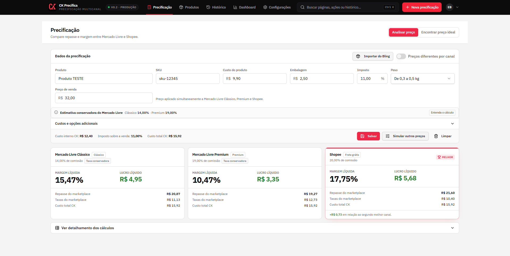
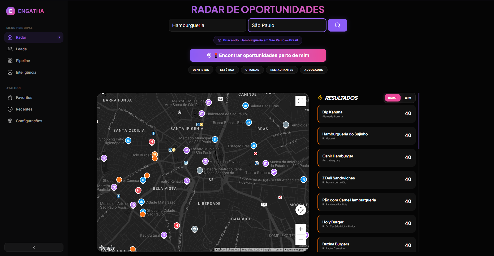
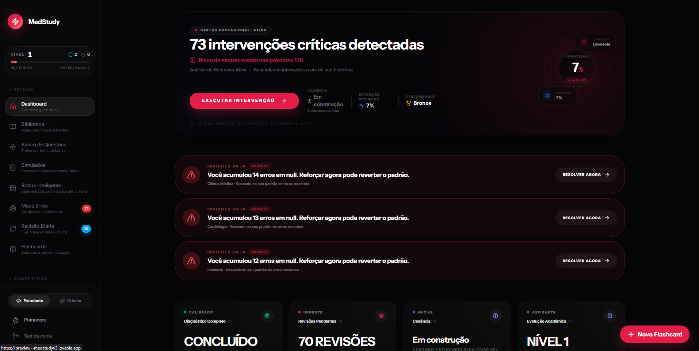

# Eduardo Barbosa | Desenvolvedor Full Stack

**Portfólio profissional · Projetos reais · Engenharia de software · Experiência de produto**

[**🌐 Acessar portfólio**](https://eduardo-barbosa-portfolio.pages.dev/) · [**💼 LinkedIn**](https://www.linkedin.com/in/eduardobdev/) · [**✉️ E-mail**](mailto:eduardobarbosadossantos02@gmail.com)

---

Portfólio profissional de **Eduardo Barbosa**, Desenvolvedor Full Stack, dedicado a apresentar projetos, decisões de engenharia e experiências com sistemas utilizados em operações reais.

O site reúne estudos de caso, capturas das aplicações, decisões de arquitetura, desafios técnicos e demonstrações ilustrativas. A proposta é mostrar não apenas o resultado visual, mas **por que cada produto existe, como foi construído e quais problemas procura resolver**.

## Visão geral

- **Três estudos de caso individuais**, com contexto, galerias e decisões técnicas.
- **Interações de demonstração** para CK Precifica e LeadFinder, sempre com dados fictícios; o MedStudy é apresentado por uma jornada visual de suas funcionalidades.
- **Experiência profissional** organizada por desafios, soluções e contexto operacional.
- **Acessibilidade e responsividade:** navegação por teclado, textos alternativos, menu mobile e controle de animações.
- **SEO:** metadados, dados estruturados, `robots.txt` e sitemap.

## Projetos em destaque

| Projeto | O que resolve | Destaques |
| --- | --- | --- |
| [**CK Precifica**](https://eduardo-barbosa-fullstack-2026.dudsfnx02.chatgpt.site/projetos/ck-precifica/) | Simplifica decisões de preço e rentabilidade em marketplaces. | Comparação entre Mercado Livre e Shopee, composição de custos, margem e lucro líquido, simulação de preço-alvo, catálogo de produtos, integração com o Bling, histórico e dashboard. |
| [**LeadFinder**](https://eduardo-barbosa-fullstack-2026.dudsfnx02.chatgpt.site/projetos/leadfinder/) | Reúne descoberta de empresas e contexto para prospecção comercial. | Busca geográfica por segmento, enriquecimento de dados, extração do DNA visual de sites, diagnósticos assistidos por IA, CRM e pipeline. |
| [**MedStudy**](https://eduardo-barbosa-fullstack-2026.dudsfnx02.chatgpt.site/projetos/medstudy/) | Organiza a rotina de estudos de estudantes de Medicina. | Flashcards, revisão espaçada, acompanhamento da aprendizagem e recursos de engajamento. Nasceu de uma dificuldade real vivida por uma estudante de Medicina. |

Cada projeto possui uma página própria com contexto, funcionalidades, imagens e detalhes técnicos. As demonstrações usam dados fictícios e não substituem os produtos originais.

### Capturas dos produtos

| CK Precifica | LeadFinder | MedStudy |
|:---:|:---:|:---:|
|  |  |  |

## Tecnologias e competências

O portfólio destaca experiências com:

- **Frontend:** React, TypeScript, JavaScript e interfaces responsivas.
- **Backend e dados:** Node.js, Python, PostgreSQL, SQL e Supabase.
- **Integrações:** APIs REST, webhooks, sistemas ERP e serviços externos.
- **Automação e infraestrutura:** n8n e Docker.

> **Importante:** essa lista representa tecnologias presentes na trajetória profissional e nos produtos apresentados. **O código deste portfólio é estático**, feito com HTML, CSS e JavaScript, sem React, backend ou banco de dados próprios.

## Estrutura do repositório

```text
.
├── README.md
└── dist/
    ├── index.html                 # Página principal
    ├── style.css                  # Estilos da página principal
    ├── motion.css                 # Transições e animações
    ├── script.js                  # Navegação e interações
    ├── favicon.svg
    ├── assets/                    # Imagens e arquivos do portfólio
    ├── robots.txt
    ├── sitemap.xml
    └── projetos/
        ├── ck-precifica/          # Estudo de caso e demonstração
        ├── leadfinder/            # Estudo de caso e demonstração
        └── medstudy/              # Estudo de caso
```

## Executar localmente

Não há etapa de compilação ou instalação de dependências para visualizar a versão estática.

Com Python 3 instalado, execute na raiz do repositório:

```bash
python -m http.server 4173 --directory dist
```

Depois, abra `http://localhost:4173` no navegador.

Use um servidor HTTP local em vez de abrir o HTML diretamente pelo sistema de arquivos, para preservar a resolução dos caminhos absolutos de imagens, scripts e páginas.

## Experiência e princípios de interface

- Menu responsivo com acesso às principais seções.
- Animações de entrada, transições e efeitos de interação.
- Controle discreto na navegação para ativar ou desativar as animações, com preferência salva no navegador.
- Linha do tempo de experiência profissional.
- Estudos de caso individuais com galerias e explicações técnicas.
- Demonstrações ilustrativas com dados fictícios quando fizer sentido para o produto.
- Recursos de compartilhamento e indexação para facilitar a descoberta pública.

## Organização e manutenção

- O conteúdo principal fica em `dist/index.html`; as páginas de projetos ficam em `dist/projetos/`.
- Estilos globais e animações ficam em `dist/style.css` e `dist/motion.css`.
- Os scripts em `dist/script.js` e `dist/projetos/` controlam as interações correspondentes.
- Ao atualizar imagens, revise os textos alternativos (`alt`) e a apresentação em dispositivos móveis.
- Ao alterar caminhos de arquivos, confira os links internos e as rotas dos estudos de caso.

Os exemplos de métricas, demonstrações e análises devem ser interpretados conforme as observações exibidas nas páginas. As análises assistidas por IA descritas no LeadFinder fazem parte das funcionalidades desse produto.

## Publicação

Esta é uma aplicação estática: qualquer hospedagem que sirva arquivos HTML, CSS, JavaScript e imagens pode publicar o conteúdo da pasta `dist/` como raiz do site.

**Atenção:** o domínio público acima é o ambiente atualmente publicado. O repositório do portfólio documenta sua interface e seus estudos de caso; ele não contém o código-fonte integral dos três produtos apresentados.

## Uso do conteúdo

Os textos, imagens pessoais e capturas de produtos representam o portfólio profissional de Eduardo Barbosa. A disponibilização pública deste repositório não constitui, por si só, uma licença para reutilização comercial desses materiais.

## Contato

- **Profissional:** Eduardo Barbosa — Desenvolvedor Full Stack
- **LinkedIn:** [linkedin.com/in/eduardobdev](https://www.linkedin.com/in/eduardobdev/)
- **E-mail:** [eduardobarbosadossantos02@gmail.com](mailto:eduardobarbosadossantos02@gmail.com)
- **WhatsApp:** [Entrar em contato](https://wa.me/5511940793966)

